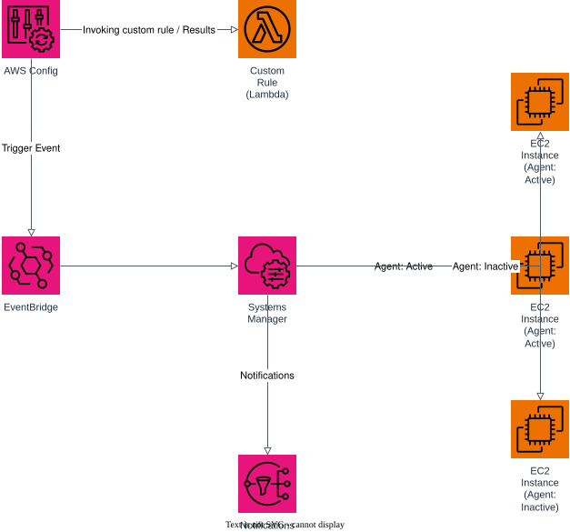

# EC2 Compliance Check

A demo of an automated compliance workflow for EC2 instances, based on the AWS
Cloud Quest scenario: *"AWS Config checks Amazon EC2 instances hourly,
identifying noncompliant ones, initiating an Amazon EventBridge alert through
Systems Manager."*

## Architecture



| Component | Purpose |
| --- | --- |
| **AWS Config** | Configuration recorder + delivery channel scoped to `AWS::EC2::Instance`, evaluated hourly. |
| **Custom Rule (Lambda)** | `config_rule_evaluator` — checks every EC2 instance for a required `CostCenter` tag and reports `COMPLIANT`/`NON_COMPLIANT` back to Config via `PutEvaluations`. |
| **EventBridge** | Rule matching Config's *"Config Rules Compliance Change"* events where `complianceType = NON_COMPLIANT`, and routes them to a Systems Manager Automation document. |
| **Systems Manager Automation** | Document that tags the flagged instance (`ComplianceStatus=NON_COMPLIANT`) and publishes a notification. |
| **EC2 Instances** | Instances managed by the SSM Agent — some compliant/active, some flagged/inactive. |
| **SNS** | Publishes an email notification to the compliance team when remediation runs. |

### Flow

1. AWS Config invokes the custom Lambda rule hourly against all EC2 instances in scope.
2. The Lambda evaluates each instance's tags and reports results back to Config.
3. When an instance is marked `NON_COMPLIANT`, Config emits a compliance-change event.
4. EventBridge matches the event and triggers an SSM Automation execution.
5. The Automation document tags the instance for review and publishes an SNS notification.

## Usage

This project is validated locally against [floci](https://github.com/) (a
local AWS emulator) rather than a real AWS account.

```bash
# start the local emulator (optional — used for validate-only workflow)
docker compose up -d

# validate the Terraform configuration
terraform init -backend=false
terraform validate
```

## Regenerating the diagram

```bash
python3 -m venv .diagram-venv
.diagram-venv/bin/pip install drawpyo
.diagram-venv/bin/python scripts/generate_diagram.py

# export to SVG/PNG
docker run --rm -v "$PWD/docs:/data" rlespinasse/drawio-export --format svg --output /data /data/architecture.drawio
docker run --rm -v "$PWD/docs:/data" rlespinasse/drawio-export --format png --output /data /data/architecture.drawio
```

## Cleanup

```bash
docker compose down
rm -rf .terraform .build .diagram-venv
```
